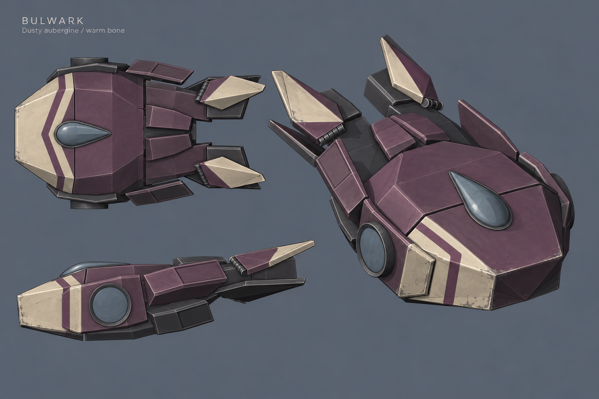

# Bulwark — broader mid-body accents

Bone-white accents now break up the plum mid-body armor: paired diagonal shoulder flashes, side-plate bands and smaller marks on the rear plates. The owner liked the placement but found the first marks too thin at distance, so their widths increased by about 65–70%. Plum remains dominant and the charcoal bridge and exposed frame stay distinct.

## Native shader views

These Unity renders use the saved source's evaluated meshes, material assignments and grayscale paint masks. The nose coat still crosses onto adjoining armor with a pointed rear boundary; the plum nose chevron and diagonal fin wedges are preserved.

## Distance and current fleet

Crimson, Vanguard, Nightshade and Valis use their current game prefab meshes and materials. Cargo is excluded. Shared cameras and lighting, with equal display size, support color and paint-readability comparison; these views do not represent relative gameplay sizes. The wider marks remain visible at 96 pixels per ship.

## Approved concept

The concept supplies the plum/bone/charcoal design language. This follow-up adds the owner's requested accents while preserving the locked geometry and approved UVs.

## Saved source and checks

Only the Blender paint material assignments, [BaseRegion mask](layers/BaseRegion.png), [palette notes](palettes.json) and [editing notes](README.md) changed. The existing Shadow, Light and Ink masks are unchanged. Color stays editable in the material nodes rather than baked into an RGB texture.

- [Geometry lock](lock-after/ship_lock.json): pass; every geometry fingerprint is unchanged.
- [UV density](uv-after/ship_uv.json): pass, max/min 1.000032 against 2.0; every UV fingerprint matches the approved cockpit-seam layout.
- [Paint validation](paint-validation.json): grayscale 2048 masks, unchanged Unity scene state and selection, no existing materials dirtied.
- [Source check](check-after/ship_check.json): the same 60 inherited findings, none added or exempted; full source validation still fails on those findings.
- [Source audit](paint-source-audit.json): SHA256 `057bc5e39d37d00c172aea4c52c35b7374f098b23b199d0b517f82b6b6bc1e45`; source revision `c6768e32db3b8bd0cd89e92998d24012bdbcae7b`.

This paint revision awaits owner review. Captures use temporary meshes and materials through the existing Unity shader. Gameplay-prefab integration, flight approval and merge remain separate.

[Editable source](Bulwark.blend) · [Previous paint review](../2026-10-13-r04/REVIEW.md) · [PR #989](https://github.com/amindell11/astronomical-home/pull/989) · [Owner scope and width correction](https://github.com/amindell11/astronomical-home/issues/963#issuecomment-6158066939)
